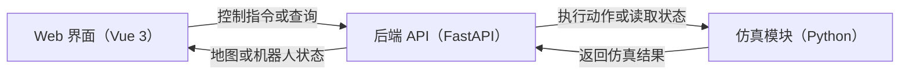

# 项目架构与接口

## 架构图

| 模块 | 实际职责 | 代码目录或入口 |
| --- | --- | --- |
| Web 界面 | 用 SVG 绘制地图、障碍物和机器人，提供手动控制和巡检操作，显示巡检进度和前方传感器数据 | `frontend/src/App.vue` |
| 后端 API | 接收控制指令和查询请求，调度巡检任务，返回地图、机器人状态、巡检进度和传感器数据 | `backend/app/main.py` |
| 仿真逻辑 | 模拟机器人移动和转向，检查边界与障碍物，规划巡检路径并计算前方传感器数据 | `backend/simulation/`、`backend/pathplanning/`、`backend/sensors/` |

## 数据约定

- 地图以左上角为原点 `(0, 0)`，`x` 向右增大，`y` 向下增大。坐标以网格为单位，每移动一格，所在轴的坐标变化 1。
- 地图大小由 `width` 和 `height` 表示，当前为 16 列 × 12 行。有效坐标为 `0 ≤ x < width`、`0 ≤ y < height`。`obstacles` 是障碍物坐标列表，每项为 `[x, y]`。
- 机器人状态中的 `x`、`y` 表示所在格的坐标，`heading` 表示朝向（`0` 向上、`90` 向右、`180` 向下、`270` 向左），`status` 表示运行状态，例如 `idle`（空闲）和 `patrolling`（巡检中）。
- 页面加载时读取地图和机器人状态，随后每 500 毫秒查询 `GET /api/robot` 刷新机器人状态。手动控制成功时直接用操作响应更新状态，收到失败响应时显示错误提示并重新查询机器人状态。
- 前端每 500 毫秒查询 `GET /api/sensors/front`，刷新传感器面板的 `blocked` 和 `distance`。
- 巡检启动成功后，前端每 500 毫秒查询 `GET /api/patrol/progress` 更新进度。如果上一次进度请求还没返回，就跳过本次查询。收到 `active: false` 时，界面将巡检状态设为空闲并停止进度轮询。

## 接口约定

| 用途 | 方法与路径 | 请求参数或请求体示例 | 成功响应示例 | 失败响应示例 |
| --- | --- | --- | --- | --- |
| 获取地图 | `GET /api/map` | 无 | `200 OK`，`{"width":16,"height":12,"obstacles":[[5,3],[5,4],[6,4],[10,7],[11,7]]}` | 无自定义失败响应。 |
| 获取机器人状态 | `GET /api/robot` | 无 | `200 OK`，例如 `{"x":1,"y":1,"heading":90,"status":"idle"}` | 无自定义失败响应。 |
| 发送手动控制指令 | `POST /api/robot/move` | `{"action":"turn_left"}`，可选 `forward`、`back`、`turn_left`、`turn_right` | `200 OK`，例如 `{"x":1,"y":1,"heading":0,"status":"idle"}` | `400`：`INVALID_ACTION`（不支持的指令）。`409`：`OUT_OF_BOUNDS`（越界）、`OBSTACLE_BLOCKED`（遇到障碍）、`PATROL_BLOCKED` 或 `PATROL_ALREADY_RUNNING`（巡检限制）。 |
| 读取前方传感器 | `GET /api/sensors/front` | 无 | `200 OK`，例如 `{"blocked":false,"distance":2}`，表示前方有两格可通行 | 无自定义失败响应。 |
| 启动巡检 | `POST /api/patrol/start` | `{"points":[[4,8],[12,3],[14,10]]}`，按数组顺序巡检 | `200 OK`，返回 `total`（路径段数）、`steps`（计划移动格数）和 `status`（`patrolling`） | `409`，`PATROL_ALREADY_RUNNING`（巡检已在进行）或 `TARGET_UNREACHABLE`（巡检点不可达）。 |
| 停止巡检 | `POST /api/patrol/stop` | 无 | `200 OK`，提交停止信号并返回当前机器人状态，包含 `x`、`y`、`heading`、`status` | 无自定义失败响应。 |
| 查询巡检进度 | `GET /api/patrol/progress` | 无 | `200 OK`，返回 `active`、`total`、`current`、`done`。无巡检记录时返回 `{"active":false,"total":0,"current":0,"done":false}` | 无自定义失败响应。 |

可执行的请求命令和预期结果填写在[后端 README](../backend/README.md)。
